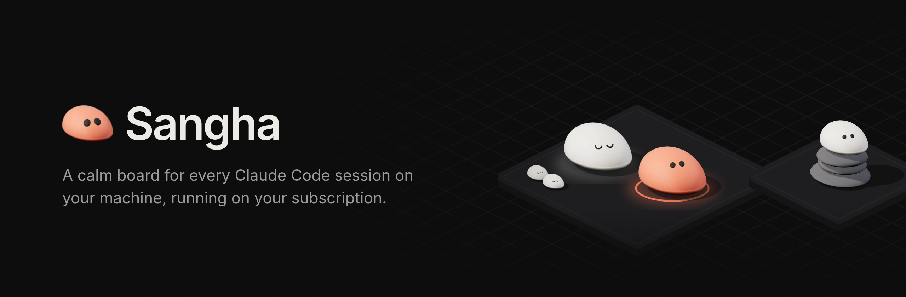

<p align="center">
  
</p>

<p align="center">
  
  
  
</p>

Sangha is a local web app for running and following Claude Code sessions across all your projects. Every project is a zone on an isometric board and every session is a pebble on it: you see at a glance which ones are working, which ones need you, and which ones have grown too big and should start fresh. Open one and you get the full conversation, its subagents, its branch and its context, and you can reply from there.

It runs on your Claude Pro or Max subscription through the [Claude Agent SDK](https://docs.claude.com/en/api/agent-sdk/overview), never on the paid API: the server refuses to start if `ANTHROPIC_API_KEY` is set.

## What it does

- **Every session in one place.** Sessions started from Sangha, and the ones you run in a terminal or an IDE, show up on their project automatically, with their subagents and any headless `claude -p` they launch.
- **Knows when you are needed.** A session that finishes or asks a question turns coral, rings once and moves to the top of the sidebar, with a two-line recap of what it did and what it waits for.
- **One worktree per session.** Each session works on its own `sangha/…` branch next to your checkout, so several can run on the same repo without stepping on each other.
- **An orchestrator you can talk to.** Ask it to start, follow or hand off sessions for you (`⌘K`).
- **Context under control.** The context size is always visible; past 400K tokens Sangha proposes a fresh session that keeps the branch, worktree and agent.
- **The rest of the toolbox.** Autonomy (goals and loops), per-session environment variables and MCP servers, Remote Control from claude.ai, quota and reserve, cost at API prices, closed sessions with search, and an Advisor that turns your feedback into improvements.

## Quick start

Requirements: Node 24+, git, and Claude Code signed in on this machine.

```sh
make setup    # .env, npm dependencies, pinned plugins
make dev      # http://127.0.0.1:8787
```

Add a project from the board: a folder on your machine (Sangha suggests the repos where Claude Code ran in the last 14 days) or a git URL, cloned into `workspaces/`.

## Running it

| Mode | Command | Notes |
|---|---|---|
| Development | `make dev` | Hot reload for the interface. The server does not restart on code changes, because the sessions it runs live inside it: restart `make dev` yourself (running sessions come back as interrupted, with Resume). |
| Background | `make serve` | Production build, interface and API on the same port, data in `data/`. `make status`, `make stop`, logs in `data/sangha.log`. |
| Docker | `make token` then `make up` | For a remote host. Detecting the sessions of your own machine does not work from the container. `make logs`, `make down`. |

All three serve http://127.0.0.1:8787, so only one can run at a time. Run `make help` for every target.

## Configuration

Settings live in `.env` (created by `make setup` from `.env.example`):

| Variable | Default | Purpose |
|---|---|---|
| `CLAUDE_CODE_OAUTH_TOKEN` | empty | Subscription token, required in Docker only (`make token`) |
| `SANGHA_ORCHESTRATOR_MODEL` | `sonnet` | Model of the orchestrator |
| `SANGHA_LEAD_MODEL` | `opus` | Model of the built-in Team lead agent |
| `SANGHA_SUBAGENT_MODEL` | `sonnet` | Model of the Team lead's subagents |
| `SANGHA_RECAP_MODEL` | `haiku` | Small model writing recaps and summaries |
| `SANGHA_EXTERNAL_WINDOW_MIN` | `90` | How long an inactive terminal session stays on the board |
| `SANGHA_PORT` | `8787` | Port of the app |

Project agents (`.claude/agents/*.md`) run as the session's main agent with the model of their own definition; they must be committed, since sessions read them from their worktree. The git identity sessions commit with is set in the app, under Settings.

## How it works

```
apps/server       Hono + Claude Agent SDK
  session.ts        one long-lived Claude process per session, resumed after 20 min idle
  orchestrator.ts   the orchestrator, with an in-process MCP server to list, start and drive sessions
  observer.ts       picks up sessions started outside Sangha from ~/.claude/projects
  recap.ts          small-model calls: recap on stop, progress point, summaries
  git.ts            one worktree per session, in workspaces/.worktrees/<project>/
  db.ts             SQLite (node:sqlite): sessions, event log
apps/web          React 19, Vite, Tailwind v4, shadcn/ui on Base UI
packages/shared   the event contract between server and web
```

The web follows two server-sent event streams: `/api/events` for the whole board and `/api/sessions/:id/events` for one conversation. The pebbles are 3D renders made with three.js; `python3 apps/web/scripts/pebbles/build.py` regenerates them.

```sh
make test         # server tests
make typecheck    # server and web
make lint         # ESLint, with the project's own rules
```

## Security

Sessions run with `bypassPermissions`, confined to `workspaces/` and, in Docker, to a non-root container. The app listens on `127.0.0.1` only: do not expose it without authentication in front, it runs code. It is meant for personal use, since Anthropic's terms do not allow sharing subscription access with others.

## Known limits

- You cannot write into a session running in a terminal (two processes on one session would conflict). Reply where it runs; once its terminal closes, replying from Sangha resumes it.
- Session detection reads `~/.claude/projects` and the local process list, so it works with `make dev` and `make serve`, not from Docker. Docker also only sees projects inside `workspaces/`.
- Subagents cannot be messaged directly; you talk to them through their session.
- Cloning a private repository from Docker needs git credentials inside the container, which are not wired yet.
